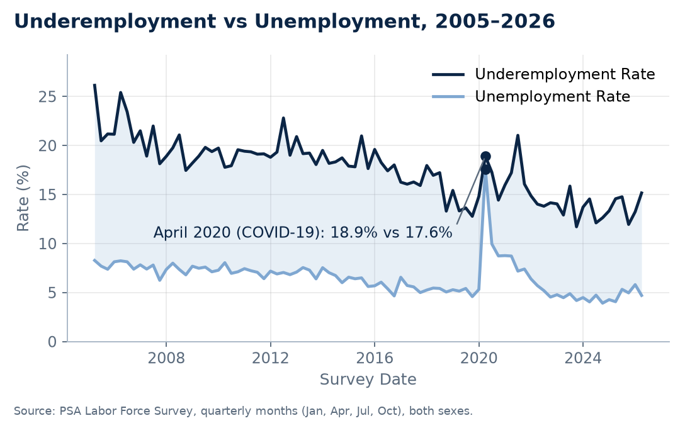
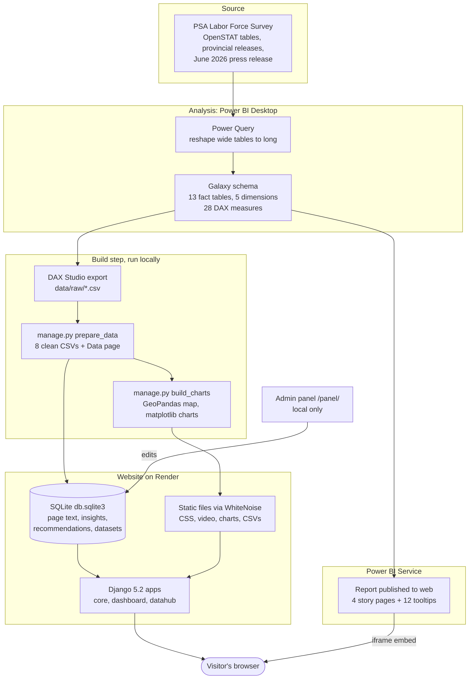
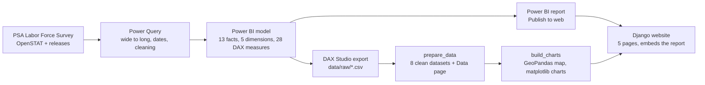
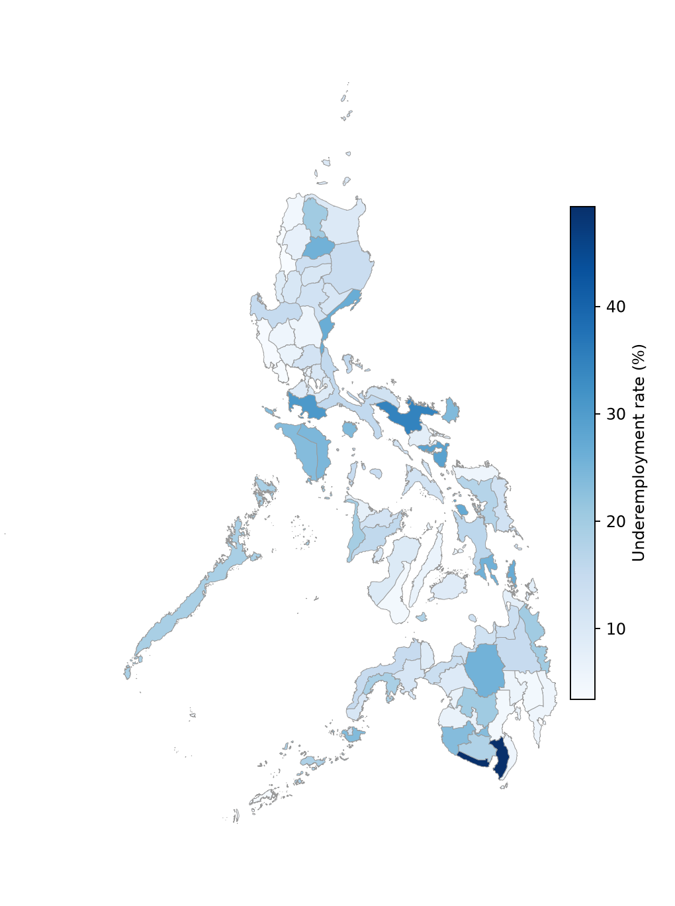

# The Shape of Work: Underemployment and Job Quality in the Philippine Labor Market

**A data story website on the hidden half of the Philippine labor market: people who have a job but not enough work.**

**Live site: [shapeofwork-dstfinalproject.onrender.com](https://shapeofwork-dstfinalproject.onrender.com/)** (free hosting: the first visit after a quiet spell can take up to a minute to wake up)

Official unemployment figures make the Philippine labor market look steadily healthier, but they do not show whether people's jobs give them enough work. *The Shape of Work* analyzes 21 years of Philippine Statistics Authority (PSA) Labor Force Survey data (April 2005 to June 2026), models it in Power BI, and tells the result as a three-act data story on a Django website that embeds the Power BI report.

Final project for **DS 009 Data Storytelling** at the Technological Institute of the Philippines (TIP), aligned with SDG 8 (Decent Work and Economic Growth), SDG 10 (Reduced Inequalities) and SDG 5 (Gender Equality).

> **Underemployment hits hardest where pay is lowest and work is seasonal. Finishing school lowers the risk but does not remove it.**

| Headline numbers | |
|---|---|
| Underemployed Filipinos, June 2026 | **6.1 million** |
| Average underemployment vs unemployment since 2005 | **17.6% vs 6.6%** (2.7 times) |
| Same, since 2021 | **13.2% vs 5.1%** (2.6 times) |
| Range across provinces (2023-2025) | **about 25 times**: Sarangani 49.3% to Zamboanga City 2.0% |
| Highest-risk sector | **Agriculture, 18.9%**, also the lowest paid (₱299 a day) |



## Contents

- [In plain words](#in-plain-words)
- [Problem statement and research questions](#problem-statement-and-research-questions)
- [Data](#data)
- [System architecture](#system-architecture)
- [How it was built](#how-it-was-built)
- [Findings](#findings)
- [Recommendations](#recommendations)
- [The website](#the-website)
- [Repository structure](#repository-structure)
- [Run it locally](#run-it-locally)
- [Rebuild the data and charts](#rebuild-the-data-and-charts)
- [Deploy](#deploy)
- [Limitations and future work](#limitations-and-future-work)
- [Team](#team)
- [Glossary](#glossary)
- [References](#references)

---

## In plain words

The Philippines' unemployment rate looks low and keeps falling, but it does not count people who *have* a job and still need more hours or more work. They are called *underemployed*, and there are about 6.1 million of them. I took 21 years of government survey data, organized it in Power BI, and built a website that walks visitors through the story in three parts: how big the problem is, who it hits hardest, and why. The short answer: people in low-paying, seasonal work (especially farming and fishing) are most affected, and finishing school helps but does not fully protect you.

## Problem statement and research questions

**Falling unemployment does not show whether Filipino workers have enough work.** PSA's own survey shows underemployment averaging 17.6% since 2005 against 6.6% for unemployment; economists at the Philippine Institute for Development Studies describe its slower decline as a continuing job-quality problem; and SDG Target 8.5 commits countries to full and productive employment, which the unemployment rate alone cannot measure.

The study asks three overarching questions, one per act of the story, answered through eight sub-questions (SQ):

| Act | Overarching question | Sub-questions |
|---|---|---|
| I · Trends | How has underemployment compared with unemployment from 2005 to 2026? | SQ1 the headline gap · SQ2 seasonality |
| II · Impact | How does underemployment vary across provinces, sex, age groups and sectors? | SQ3 provinces · SQ4 sex and age · SQ5 sectors |
| III · Reality | How are working hours, education and pay related to underemployment? | SQ6 visible vs invisible, reasons for short hours · SQ7 education · SQ8 pay |

## Data

All data comes from the PSA Labor Force Survey: tables downloaded from [PSA OpenSTAT](https://openstat.psa.gov.ph/), the provincial labor market releases, and the June 2026 LFS press-release tables. Each chapter uses the window its source actually covers:

| Model table | Coverage | Used for |
|---|---|---|
| `Fact_Rates`, `Fact_Levels` | Apr 2005 - Jun 2026 | SQ1-2, sector totals |
| `Fact_AgeGroup` | Apr 2005 - Jun 2026 | SQ4, SQ6 |
| `Fact_Provincial` | 2023 - 2025 (2025 preliminary) | SQ3 |
| `Fact_SectorUnderemployment` | Jun 2025, Jan - Jun 2026 | SQ5, SQ8 |
| `Fact_Industry_Current` | Jan 2012 - Jun 2026 | Sector employment (rate denominator) |
| `Fact_Pay` | Jan 2016 - Apr 2026 | SQ8 |
| `Fact_Education` | Jan 2023 - Jun 2026 | SQ7 |
| `Fact_Underemployment_Reasons` | Jun 2025, Jan - Jun 2026 | SQ6 |
| `Fact_ClassOfWorker` | Apr 2005 - Jun 2026 | Synthesis |

Through 2020 the national series is quarterly (January, April, July, October); from 2021 it is monthly. A **View Mode** slicer compares like with like: quarterly months across all 21 years, or every month since 2021.

The tables exported from Power BI are in [`data/raw/`](data/raw/); the eight tidy datasets built from them are in [`data/clean/`](data/clean/) and can be downloaded from the website's **Data** page.

## System architecture

The project has two halves. The **analysis** half is a Power BI model built from PSA tables and published to the Power BI cloud. The **website** half is a Django app that tells the story, embeds the published report, draws the Python charts Power BI cannot show on the web, and offers the clean data for download.



| Layer | What it does | Technology |
|---|---|---|
| Data preparation | Turns PSA's wide tables into long, typed tables | Power Query (M) |
| Data model | Facts and dimensions, relationships, measures | Power BI, DAX |
| Report hosting | Serves the interactive report pages | Power BI Service, Publish to web |
| Data export | Copies model tables out of Power BI | DAX Studio |
| Data pipeline | Cleans exports, checks them against the paper, loads the Data page | Django management commands, pandas |
| Python charts | Province choropleth and education bubble chart | GeoPandas, matplotlib |
| Web app | Pages, insights, downloads, search | Django 5.2, templates, SQLite |
| Serving | Web server and static files | gunicorn, WhiteNoise, Render (or Vercel) |
| Content editing | Edit text and uploads, then commit `db.sqlite3` | Custom Django admin panel (local only) |

**One request, step by step:** the browser asks Render for a page; Django reads that page's text and insights from SQLite and renders the template; the template includes an `<iframe>` that loads the matching report page straight from Power BI's servers, plus the pre-drawn PNG charts served by WhiteNoise.

## How it was built



1. **Power Query.** Every PSA table arrives wide (one column per indicator, sex, age or industry) and is reshaped into a long table: one row per date, category and value. Common steps: promote headers, drop "Annual" rows, build a real date, drop subtotal columns so nothing is double-counted, unpivot, then split the attribute into its parts.
2. **Power BI model.** A **galaxy schema** of 13 fact tables sharing five dimensions (`Dim_Date`, `Dim_Year`, `Dim_Sex`, `Dim_AgeGroup`, `Dim_Sector`) plus a disconnected `View Mode` table. Every relationship is many-to-one and single-direction; Auto date/time is off.
3. **28 DAX measures**, for example the slicer-aware rates, the *distress multiplier* (underemployment ÷ unemployment), the derived sector rate, the national benchmark line, Pareto shares of the reasons for short hours, and education-rate volatility.
4. **Derived sector rate.** PSA publishes only each sector's *share* of the underemployed, so the true rate is computed as (total underemployed × sector share) ÷ sector employment.
5. **Website.** Power BI's Python visuals do not render in a web embed, so the province map was rebuilt as an Azure Maps visual inside the report, and Django draws the Python charts on the server (a GeoPandas choropleth and the education bubble chart).

## Findings

### Act I · Trends

- **SQ1, the headline gap:** the two rates move together, but the gap never closed. They came closest in April 2020, when COVID pushed unemployment to 17.6% against 18.9% underemployment (ratio 1.07); since 2021 the ratio has not fallen below 1.6.

  | Period | Underemployment | Unemployment | Ratio |
  |---|---|---|---|
  | 2005-2026, quarterly months | 17.56% | 6.55% | 2.68x |
  | 2021-2026, all months | 13.24% | 5.11% | 2.59x |
  | Men, 2021-2026 | 14.74% | 4.91% | 3.00x |
  | Women, 2021-2026 | 11.07% | 5.39% | 2.05x |

- **SQ2, seasonality:** since 2021, July (15.5%), April (14.7%) and January (14.2%) run highest; December, May and June lowest. The level fell in two steps: a 2005-2016 plateau (April readings 17.8% to 26.1%), then a lower level from 2017. The lowest reading on record is 7.95% (December 2025).

### Act II · Impact



- **SQ3, provinces:** across 118 provinces and highly urbanized cities, the average is 12.3%, but the highest is about 25 times the lowest. Highest: Sarangani 49.3%, General Santos City 37.9%, Camarines Sur 34.7%, Batangas 30.5%, Sorsogon 28.7%. Lowest: Zamboanga City 2.0%, Makati 2.9%, Bacolod, Ilocos Sur and Pasig 3.4%. High rates cluster in SOCCSKSARGEN and Bicol; four of the five lowest are cities.
- **SQ4, sex and age:** men are more underemployed than women in every age group (14.7% vs 11.0%), with the widest gap at 15-24 (4.1 points). Workers aged 35-54 are the most underemployed; for the young, the bigger problem is unemployment (12.3%).
- **SQ5, sectors:** Services holds the most underemployed workers (52.9%), but Agriculture carries the highest risk per worker.

  | Sector | Share of underemployed | Share of employment | Underemployment rate |
  |---|---|---|---|
  | Agriculture | 29.1% | 19.5% | **18.9%** |
  | Industry | 18.0% | 17.9% | 12.7% |
  | Services | 52.9% | 62.6% | 10.6% |

<br clear="right">

### Act III · Reality

- **SQ6, hours:** about 61% of the underemployed are *visibly* underemployed (working under 40 hours) and 39% *invisibly* (full hours, wanting more work). The visible share rises with age, from 54% at 25-34 to 78% at 65+. Variable working time set by the job is the top reason for short hours every month (63.4% to 71.9% of answers).
- **SQ7, education:** completing college, junior high or elementary lowers the rate; senior high barely changes it (11.8% vs 11.7%). Even college graduates, the lowest group, sit at 7.2%, against 16.7% with no grade completed.
- **SQ8, pay:** at the sector level, pay and underemployment move in opposite directions: Agriculture ₱299 a day and 18.9%, Industry ₱542 and 12.7%, Services ₱695 and 10.6%. With three data points this is a pattern, not proof of cause.

**The twist:** 60.85% of employed Filipinos are wage-and-salary workers, so a regular paycheck is the norm, yet about 1 in 8 workers still wants more work.

## Recommendations

- **Report underemployment alongside unemployment** (SQ1): the headline rate alone hides a two-decade gap.
- **Off-season income support in farming and fishing provinces** such as Sarangani and Bicol (SQ2, SQ3, SQ5, SQ8): work programs between planting and harvest, not only wage increases.
- **Strengthen the school-to-work transition for youth** (SQ4).
- **Promote more predictable working hours** (SQ6).
- **Help students finish college, junior high and elementary** (SQ7).

The website adds a sixth: review how senior high prepares students for work, since finishing senior high barely changes the rate (SQ7).

## The website

Visitors browse every page without signing in.

| Page | Address | Content |
|---|---|---|
| Home | `/` | Hook, stat bar (6.1 million underemployed · 13.2% since 2021 · 21 years of data), the "Unemployed vs Underemployed" explainer, the story video |
| Overview | `/dashboard/` | The full Power BI report |
| Trends · Act I | `/dashboard/trends/` | SQ1-2: the embedded report page plus insight cards |
| Impact · Act II | `/dashboard/impact/` | SQ3-5, with the server-drawn GeoPandas province map |
| Reality · Act III | `/dashboard/reality/` | SQ6-8, with the server-drawn education bubble chart |
| Synthesis | `/dashboard/synthesis/` | The pattern, the cause and the twist |
| Recommendations | `/dashboard/recommendations/` | The six recommendations |
| Data | `/data/` | Download the eight clean datasets, with a data dictionary and a search box |
| About | `/about/` | The team |

**Content management.** Page text, insights, recommendations and datasets live in the database (`db.sqlite3`) and are edited in a custom admin panel at `/panel/` (plus Django's own admin at `/django-admin/`). The panels need a writable database, which the live hosts do not keep, so they are **only switched on locally**: edit locally, commit the updated `db.sqlite3`, and push to redeploy.

## Repository structure

```text
├── config/                 Django settings, URLs, WSGI (Power BI report link in settings.py)
├── core/                   Home and About pages
├── dashboard/              Power BI pages, insights, recommendations
│   └── management/commands/seed_content.py   fills the site text (safe to re-run)
├── datahub/                Data page: datasets, downloads, search
│   └── management/commands/
│       ├── prepare_data.py     data/raw -> data/clean + Data page records
│       └── build_charts.py     GeoPandas map and matplotlib charts -> static/charts/
├── adminpanel/             Local-only content editor
├── templates/              HTML templates
├── static/                 CSS, logo, story video, generated charts
├── media/datasets/         The downloadable CSVs served by the Data page
├── data/
│   ├── raw/                Power BI tables exported with DAX Studio
│   ├── clean/              8 tidy datasets, one per research question
│   └── geo/                Philippine province boundaries (geoBoundaries, simplified)
├── db.sqlite3              Site content (pages, insights, recommendations, datasets)
├── requirements.txt        Packages for the website
├── requirements-dev.txt    Plus pandas, matplotlib and GeoPandas for the data commands
├── render.yaml             Render deployment
└── vercel.json             Vercel deployment (alternative)
```

## Run it locally

**Prerequisites:** Python 3.12 (the version Render uses) and Git.

```bash
git clone https://github.com/james-kalaw/datastorytelling-finalproj-djangoapp.git
cd datastorytelling-finalproj-djangoapp
python -m venv .venv
```

Activate the environment, then install and start the site:

```bash
source .venv/bin/activate          # Windows PowerShell: .\.venv\Scripts\Activate.ps1
pip install -r requirements.txt
python manage.py runserver
```

Open http://127.0.0.1:8000. All the content is already in `db.sqlite3`, so there is nothing else to set up. The admin panel is at http://127.0.0.1:8000/panel/; to make your own account there, run `python manage.py createsuperuser`.

## Rebuild the data and charts

Only needed when the PSA data is updated. Install the extra packages, export the Power BI tables to `data/raw/` with DAX Studio (**Advanced > Export Data > CSV**), then:

```bash
pip install -r requirements-dev.txt
python manage.py prepare_data
python manage.py build_charts
```

`prepare_data` prints self-checks against the published figures (for example `Sector rates: Agriculture 18.9%, Industry 12.7%, Services 10.6%` and `Province range: 49.3% / 2.0% = 24.8x`) and loads the eight datasets into the Data page. `build_charts` redraws `static/charts/` and checks the pay averages (₱299, ₱542, ₱695). Both were re-run from a fresh copy of this repository: the clean datasets came out identical and every check passed.

To restore the site text from code, run `python manage.py seed_content`.

## Deploy

**Render:** in Render, choose **New > Blueprint** and pick this repository. `render.yaml` installs `requirements.txt`, collects static files with WhiteNoise, runs gunicorn, and generates `DJANGO_SECRET_KEY`. `DEBUG` turns off automatically on Render.

**Vercel (alternative):** `vercel.json` routes requests to `config/wsgi.py` and serves `static/` and `media/`.

On a live host the site needs `DJANGO_SECRET_KEY` set; locally it uses a development key.

## Limitations and future work

| Limitation | How it is handled |
|---|---|
| Published aggregate tables only: no individual-level data, so no causal claims | Findings and recommendations are stated as patterns |
| Coverage windows differ by table | Every chart caption names its window |
| The sector rate is derived from three tables | The formula is shown on the site and in the paper |
| Only three sector rates, so pay effects within a sector cannot be tested | SQ8 is framed at the sector level |
| No industry or unemployment data by province | The farming link to provincial rates is stated as context |
| Survey design changed (quarterly to monthly in 2021; larger rounds in Jan, Apr, Jul, Oct) | View Mode compares like with like; a caution note on seasonality |
| 2025 provincial and 2026 monthly figures are preliminary | Marked (P) in captions |
| Azure Maps shades provinces only, so highly urbanized cities have no shape on the map | Their values appear in the bar charts |

**Future work:** individual-level data to test causes; test drivers of the seasonal rhythm (planting and harvest, school breaks); province-level industry and unemployment breakdowns; sex-by-sector and reasons-by-demographic tables; extend the seven-month sector snapshot into a trend; follow the small education groups over a longer window.

## Team

Technological Institute of the Philippines. Professor: Dr. Rosmina Joy Cabauatan.

**Built by James Andre L. Kalaw**, who was assigned the project and did all of it: the data preparation in Power Query, the Power BI model and its DAX measures, the report, the data pipeline and the Django website.

Course group and paper co-authors: Juliana Ysabel D.C. Detera, Josh Andrei A. Ituralde and Ramon Antonio Simon Valdestamon.

## Glossary

| Term | Meaning |
|---|---|
| Underemployed | Employed people who want more hours or more work |
| Visible underemployment | Working under 40 hours a week and wanting more hours |
| Invisible underemployment | Working full hours but wanting more or better work |
| Distress multiplier | Underemployment rate divided by unemployment rate |
| Power Query | Power BI's tool for cleaning and reshaping data before it is modeled |
| Galaxy schema | A data model with several fact tables (measurements) sharing dimension tables (dates, sex, age, sector) |
| DAX measure | A formula in Power BI, for example an average rate that follows the filters a reader picks |
| DAX Studio | A free tool that exports Power BI tables to CSV |
| Django | A Python framework for building websites |
| Management command | A Django script run from the terminal, such as `prepare_data` |
| WhiteNoise | Lets the Django app serve its own CSS, images and files on hosts without a file server |

## References

1. Araune, P. B., and Sios-e, A. C. P. 2023. Balancing Act: Underemployment Patterns and Age-Gender Diversity in Northern Mindanao. *International Journal of Research and Scientific Innovation* 10, 10, 88-95. https://doi.org/10.51244/IJRSI.2023.101008
2. Arbole, J., de la Paz, L. G., Genota, T., Hernandez, K., Dacuycuy, L. B., Rapada, M., and Yu, K. 2023. The Determinants of the Underemployment Gender Gap in the Philippines: A Decomposition Analysis. De La Salle University, Angelo King Institute. https://animorepository.dlsu.edu.ph/res_aki/179
3. Bayudan-Dacuycuy, C., Epetia, M. C. F., Vargas, A. R. P., and Ocbina, J. J. S. 2024. Inputs to the Philippine Labor Market Information System and TESDA's Skills Anticipation and Prioritization of Skills Requirements Framework. PIDS Discussion Paper No. 2024-06. https://pidswebs.pids.gov.ph/CDN/document/pidsdps2406.pdf
4. Epetia, M. C. F. 2021. COVID-19, Job Loss, and Underemployment: Who Is Affected? *The Philippine Review of Economics* 58, 1&2, 63-91. https://doi.org/10.37907/4ERP1202JD
5. Rivera, J. P. R., Ruiz, M. G. C., and Miral, R. M. L. 2024. Macroeconomic Prospects of the Philippines in 2024-2025: Toward Upper Middle-Income Status. PIDS Discussion Paper No. 2024-18. https://pidswebs.pids.gov.ph/CDN/document/pidsdps2418.pdf
6. Philippine Statistics Authority. Labor Force Survey tables, PSA OpenSTAT. https://openstat.psa.gov.ph/
